# be(BlogEngine.NET 3.3.8)を Studio で変換する

ブログのエンジンです(Web Forms、C#)。データは DB ではなく `App_Data` の XML に置きます。
Studio(画面)で解析・変換し、Windows と Linux のコンテナで動かします。コマンドラインでの手順は [こちら](../be.md) です。

入れておくもの(.NET 10 SDK、Git、Docker Desktop、**Visual Studio または Visual Studio Build Tools**)は [共通の準備の 1](../setup.md#1-入れるもの) にあります。Studio はステップ 1 で元のアプリをビルドするので、be でも Visual Studio か Build Tools が要ります。SQL Server は要りません。

## 1. FrameworkOnCore とソースを取る

作業用の空のフォルダー(例: `C:\foc`。パスは短くします)を作り、FrameworkOnCore と BlogEngine.NET のソースを取ります。

```powershell
New-Item -ItemType Directory -Force C:\foc | Out-Null
cd C:\foc
git clone https://github.com/Shkosugi-Lab/FrameworkOnCore.git
curl.exe -L -o be.zip https://github.com/rxtur/BlogEngine.NET/archive/refs/tags/v3.3.8.0.zip
tar -xf be.zip          # BlogEngine.NET-3.3.8.0 ができる
```

取得元: [rxtur/BlogEngine.NET](https://github.com/rxtur/BlogEngine.NET) タグ `v3.3.8.0`(ライセンスの表示なし)

## 2. Studio を起動する

同じフォルダーで起動します。こうすると、Studio に入れるパスをこのフォルダーからの相対パスで書けます。

```powershell
.\FrameworkOnCore\studio.ps1
```

「Studio: http://127.0.0.1:5300/」と出たら、ブラウザーで http://127.0.0.1:5300/ を開きます。止めるときは、この PowerShell で Ctrl+C を押します。

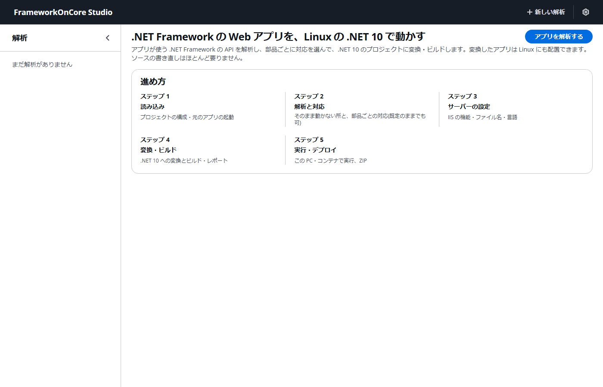

## 3. 新しい解析を作る

右上の「新しい解析」を押し、次の値を入れて「解析する」を押します。

| 欄 | 値 |
|---|---|
| プロジェクト(.csproj / .vbproj) | `.\BlogEngine.NET-3.3.8.0\BlogEngine\BlogEngine.NET\BlogEngine.NET.csproj` |
| リポジトリのフォルダー | `.\BlogEngine.NET-3.3.8.0` |
| 構成 | `Release` |

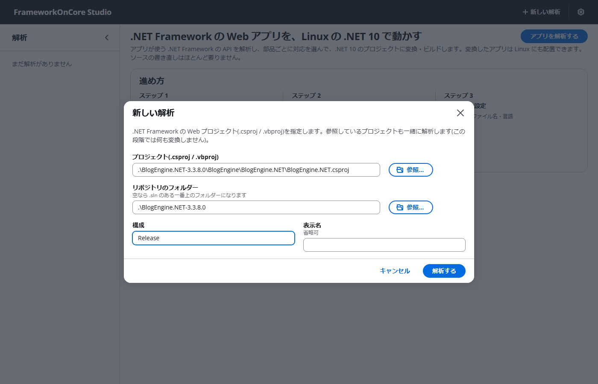

「リポジトリのフォルダー」は省けません。このアプリはソリューションの外の `lib` の DLL を参照しているためです。空のままだと参照が見つからず、変換レポートに「未解決」が 16 件出ます。

## 4. ステップ 1 読み込み

プロジェクトの構成(言語、.NET Framework の版、NuGet パッケージの数、ページの数など)が出ます。解析は裏で進みます(10 秒ほど)。

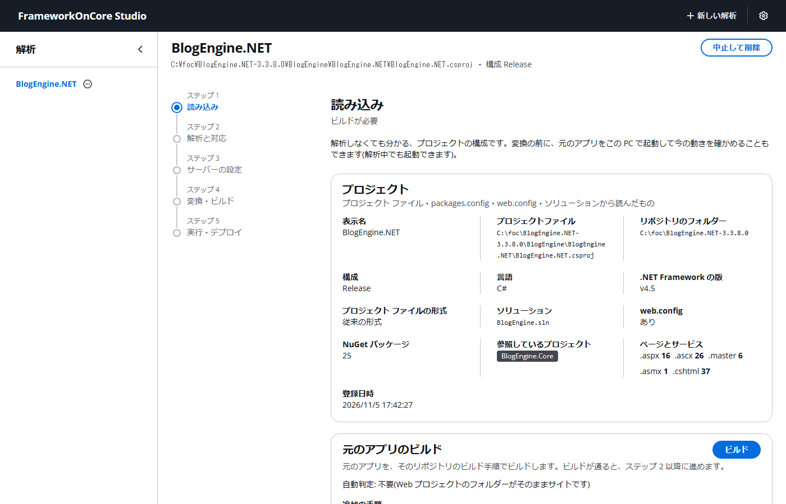

下の「元のアプリのビルド」で、「ビルドに使う MSBuild」(Visual Studio か Build Tools。入っていないほうは選べません)を確かめて「ビルド」を押します。元のアプリを、そのリポジトリのビルド手順でビルドします(be で 30 秒ほど)。**ビルドが通るまで、ステップ 2 以降には進めません。**
「追加の手順」は、ビルドのあとに別の手順が要るリポジトリ(n2 など)のためのものです。be では空のままです。

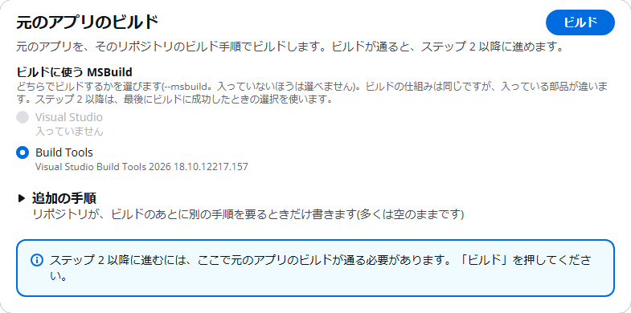

「ビルド成功」と出たら、「次へ」を押します。

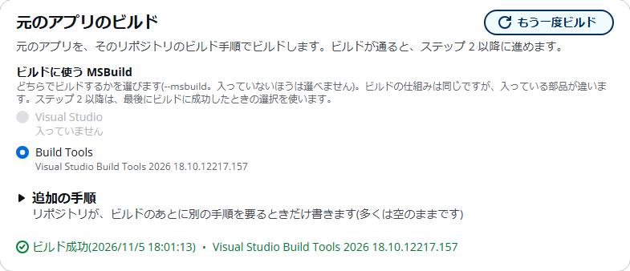

上の画面は Build Tools だけが入っている PC です。Visual Studio と Build Tools の**両方**が入っている PC では、どちらも選べます(既定は Visual Studio)。
ステップ 2 以降(変換のときの元のビルドなど)は、最後にビルドに成功したときの選択を使います。別のものに変えるときは、選び直して「もう一度ビルド」を押します。

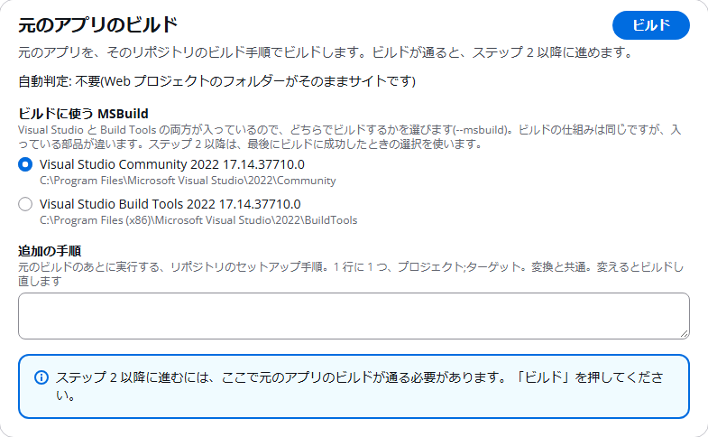

## 5. ステップ 2 解析と対応

アプリが使う .NET Framework の API と、変換での扱いが出ます。

- 「自分で対応が要る部品」は、変換だけでは動くようにならない所です(be では 6 件)。それぞれ「すること」が書かれています。
- 「対応を選ぶ部品」では、部品ごとに対応を選べます。

**既定のままで変換できます。**「次へ」を押します。

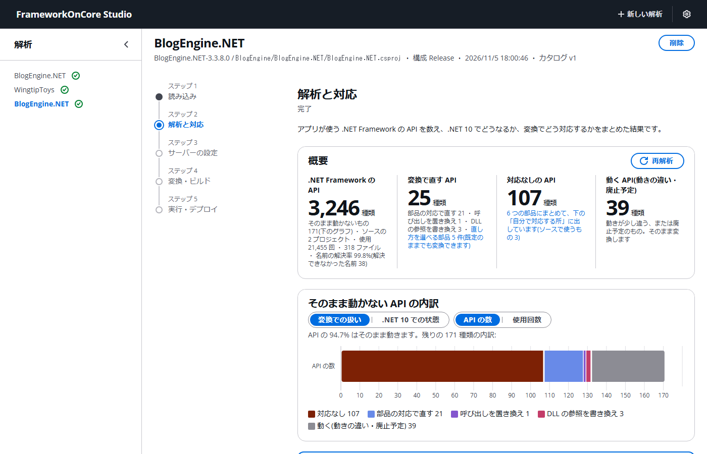

## 6. ステップ 3 サーバーの設定

IIS の機能(ファイル名の大文字・小文字、アクセス ログ、URL Rewrite、エラー ページなど)の動かし方を選べます。既定は、元の IIS と同じ動きです。

既定のまま「次へ」を押します。

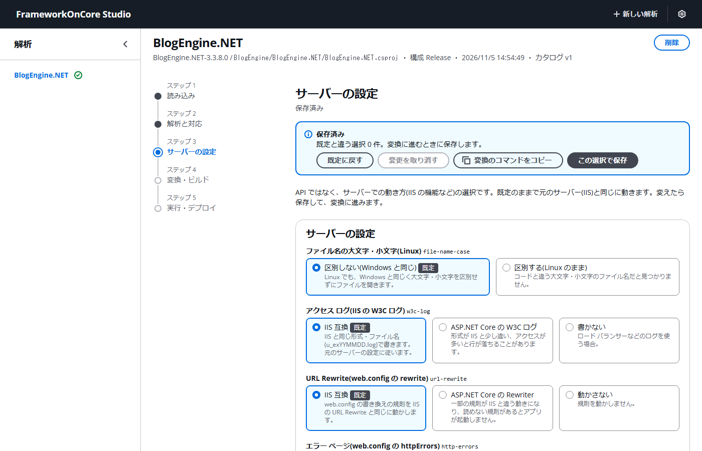

## 7. ステップ 4 変換・ビルド

「変換してビルド」を押します。変換では、元のアプリをステップ 1 と同じ手順(同じ MSBuild、同じ追加の手順)で、まっさらな状態からビルドし直し、そのサイトから組み立てます。ステップ 1 で動かした元のアプリの変更(web.config、App_Data)は入りません。

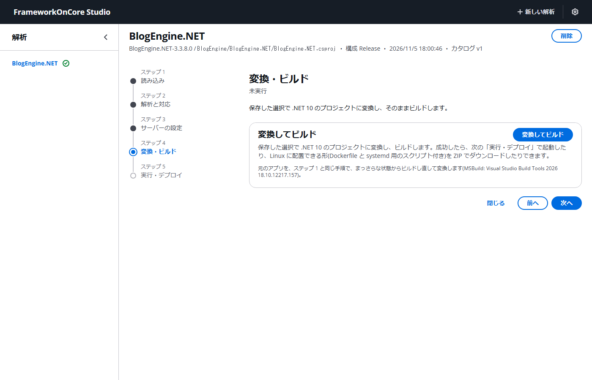

1〜2 分で「ビルド成功」になり、下に変換レポートが出ます。「未解決」が 0 であることを確かめます。
レポートの節を開くと、変換が何を変えたか(パッケージ、.NET に無い API、スタブにしたソース、Linux 用に変えたパスなど)が分かります。

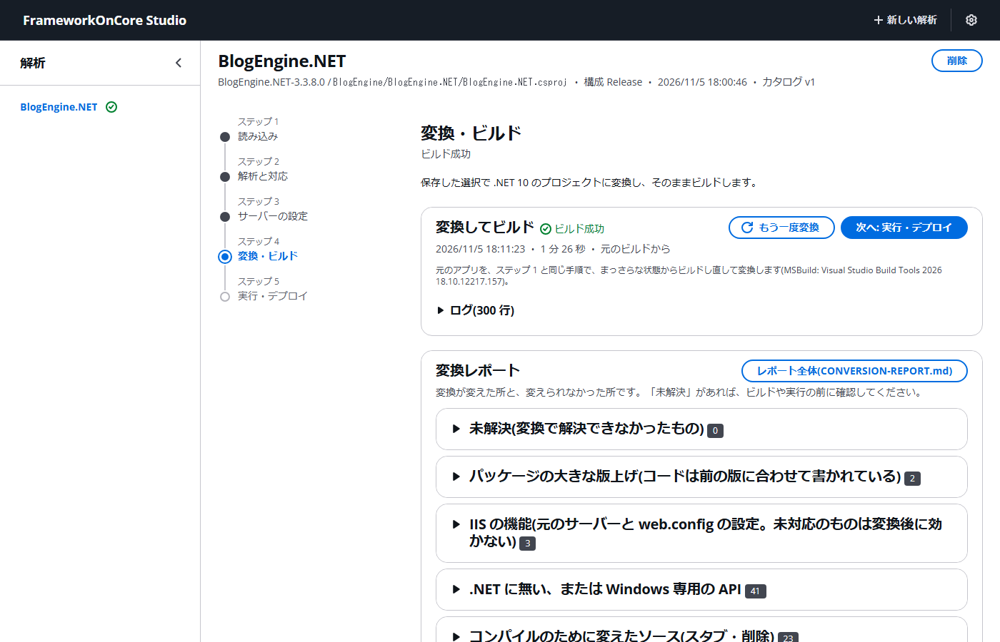

「次へ」を押します。

## 8. ステップ 5 実行・デプロイ

変換したアプリを動かします。「ZIP ダウンロード」では、変換の出力(サイト、Dockerfile、systemd 用のスクリプト)を取り出せます。

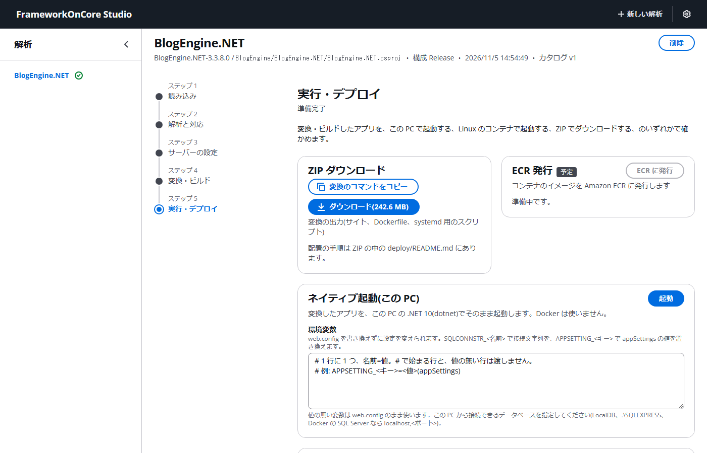

### 8.1 Windows で動かす(ネイティブ起動)

「ネイティブ起動(この PC)」の「起動」を押します。be では「環境変数」は要りません。

「実行中」になったら、URL(http://localhost:8100/ など)か「開く」を押します。最初の表示は、ページのコンパイルで 10 秒ほどかかります。止めるときは「停止」を押します。

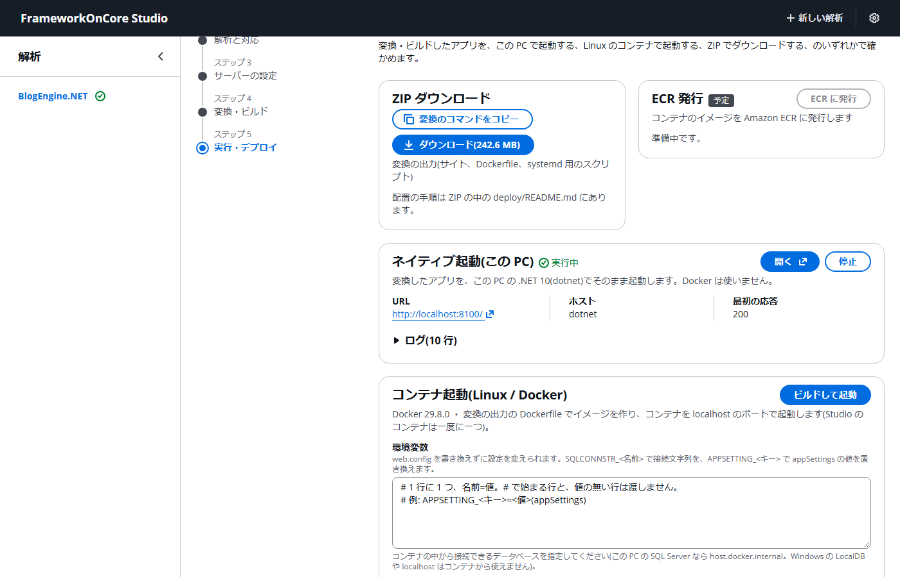

### 8.2 Linux で動かす(コンテナ起動)

Docker Desktop を起動しておきます。止まっていると「Docker Desktop を起動」ボタンが出るので、それを押しても構いません。

「コンテナ起動(Linux / Docker)」の「ビルドして起動」を押します。Dockerfile からイメージを作るので、初回は数分かかります。
「実行中」になったら、URL(http://localhost:8080/)か「開く」を押します。止めるときは「停止」を押します。

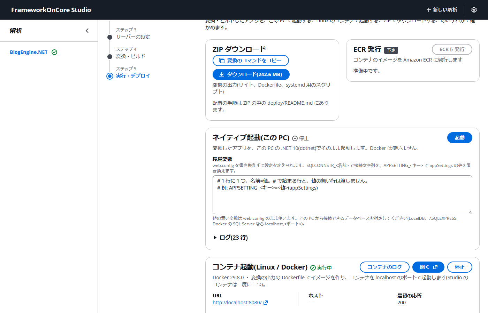

Linux のコンテナで動いている BlogEngine.NET です。管理者は `admin` / `admin` です(ログインは `/Account/login.aspx`)。

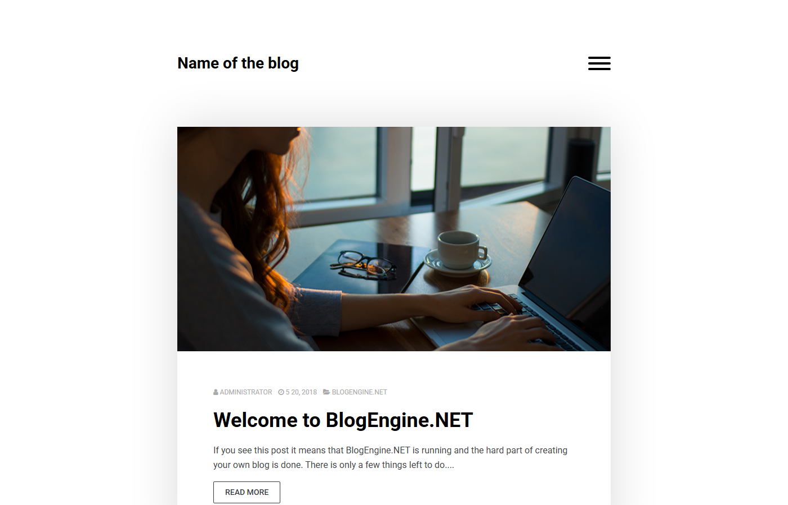

## 9. 片付け

- アプリは「停止」で止めます。Studio は、起動した PowerShell で Ctrl+C を押して止めます。Studio を止めると、Studio が起動したアプリも止まります。
- 終わったら Docker Desktop を止め、`wsl --shutdown` で WSL のメモリーを返します。
- Studio の出力は `%LOCALAPPDATA%\FrameworkOnCore\studio\` にあります。不要になった解析は、画面右上の「削除」で消せます。
