# Bootstrap2-VB-MVC を Studio で変換する

Bootstrap 2 の文書を中国語(繁体字)に訳したサイトのソースです(MVC 4、**Visual Basic**)。ビューは VB の Razor(`.vbhtml`)で書かれています。Studio(画面)で解析・変換し、Windows と Linux のコンテナで動かします。コマンドラインでの手順は [コマンド版](../bootstrap2-vb-mvc.md) です。

| | |
|---|---|
| 取得元 | [kkbruce/Bootstrap2-VB-MVC](https://github.com/kkbruce/Bootstrap2-VB-MVC) コミット `ca621388` |
| ライセンス | MIT |

入れておくもの(.NET 10 SDK、Git、Docker Desktop、**Visual Studio または Visual Studio Build Tools**)は [共通の準備の 1](../setup.md#1-入れるもの) にあります。Studio はステップ 1 で元のアプリをビルドするので、Visual Studio か Build Tools が要ります。DB は要りません。

## 1. FrameworkOnCore とソースを取る

作業用の空のフォルダー(例: `C:\foc`。パスは短くします)を作り、FrameworkOnCore を取ります。ほかのシナリオで済ませてあれば、`cd C:\foc` だけにします。

```powershell
New-Item -ItemType Directory -Force C:\foc | Out-Null
cd C:\foc
git clone https://github.com/Shkosugi-Lab/FrameworkOnCore.git
```

同じフォルダーに、アプリのソースを取ります。

```powershell
curl.exe -L -o bootstrap2-vb-mvc.zip https://github.com/kkbruce/Bootstrap2-VB-MVC/archive/ca621388bfdaedf1d69a505e863fd5ffd52ad0b5.zip
tar -xf bootstrap2-vb-mvc.zip
Rename-Item Bootstrap2-VB-MVC-ca621388bfdaedf1d69a505e863fd5ffd52ad0b5 Bootstrap2-VB-MVC
```

## 2. Studio を起動する

ソースを取ったフォルダーで起動します。こうすると、Studio に入れるパスをこのフォルダーからの相対パスで書けます。

```powershell
.\FrameworkOnCore\studio.ps1
```

「Studio: http://127.0.0.1:5300/」と出たら、ブラウザーで http://127.0.0.1:5300/ を開きます。止めるときは、この PowerShell で Ctrl+C を押します。

右上の **「新しい解析」** を押します。

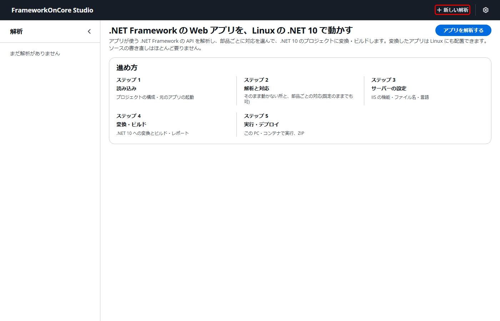

## 3. 新しい解析を作る

次の値を入れて、**「解析する」** を押します。

| 欄 | 値 |
|---|---|
| プロジェクト(.csproj / .vbproj) | `.\Bootstrap2-VB-MVC\kkbruce.tw\kkbruce.tw.vbproj` |
| リポジトリのフォルダー | `.\Bootstrap2-VB-MVC` |
| 構成 | `Release` |

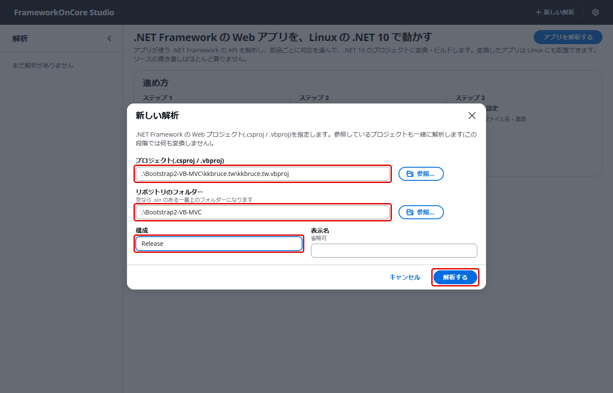

## 4. ステップ 1 読み込み

プロジェクトの構成(言語、.NET Framework の版、NuGet パッケージの数、ページの数など)が出ます。解析は裏で進みます。

下の「元のアプリのビルド」で、**「ビルドに使う MSBuild」**(Visual Studio か Build Tools。入っていないほうは選べません)を確かめて、**「ビルド」** を押します。元のアプリを、そのリポジトリのビルド手順でビルドします。**ビルドが通るまで、ステップ 2 以降には進めません。**「追加の手順」は空のままです。

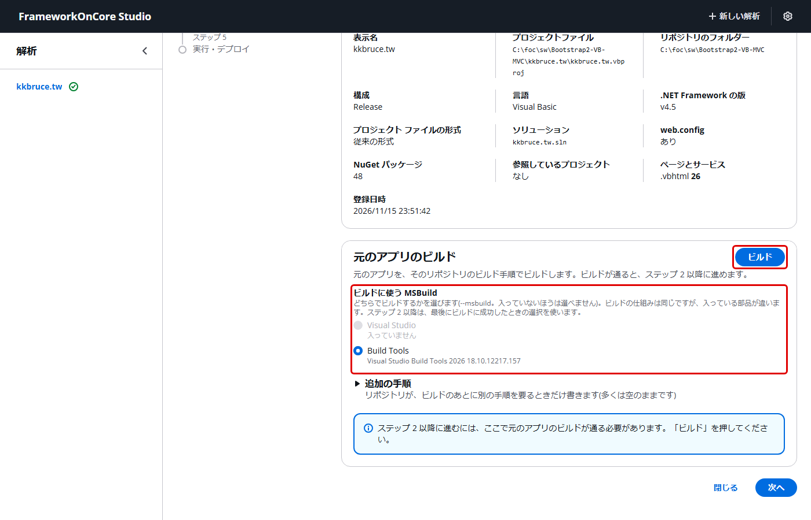

ビルド中は、その下の「ログ」にビルドの様子が出ます。**「ビルド成功」** と出たら、いちばん下の **「次へ」** を押します。

ビルドが通ると「元のアプリを起動(テスト起動)」も出ます。変換前の動きを確かめたいときに使います(IIS Express が要ります。この手順では使いません)。

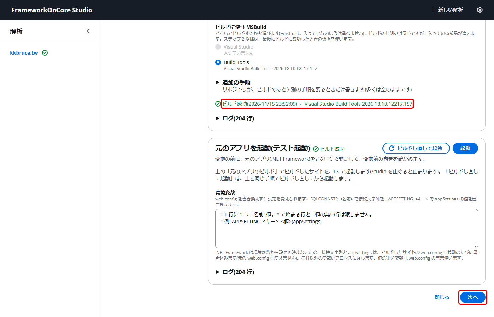

## 5. ステップ 2 解析と対応

アプリが使う .NET Framework の API と、変換での扱いが出ます。「自分で対応する所」のタブは変換だけでは動くようにならない所、「対応を選ぶ部品」のタブは部品ごとに直し方を選べる所です。

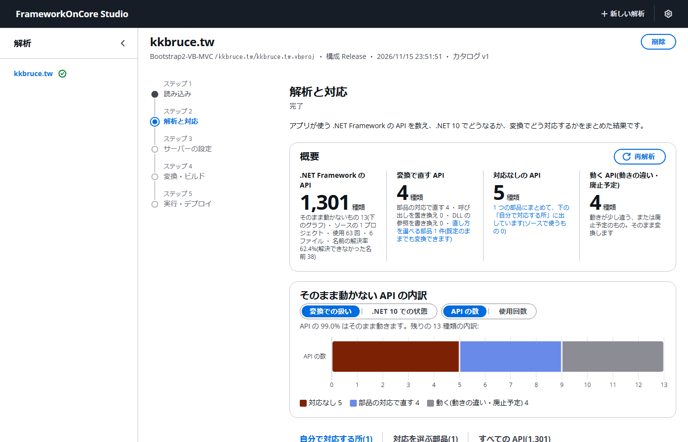

**既定のままで変換できます。** いちばん下の **「次へ」** を押します。

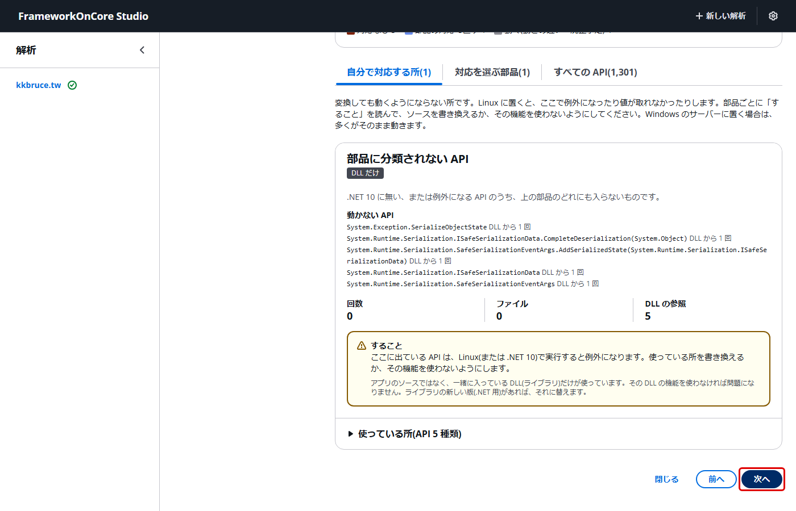

## 6. ステップ 3 サーバーの設定

IIS の機能(ファイル名の大文字・小文字、アクセス ログ、URL Rewrite、エラー ページなど)の動かし方を選べます。既定は、元の IIS と同じ動きです。既定のまま **「次へ」** を押します。

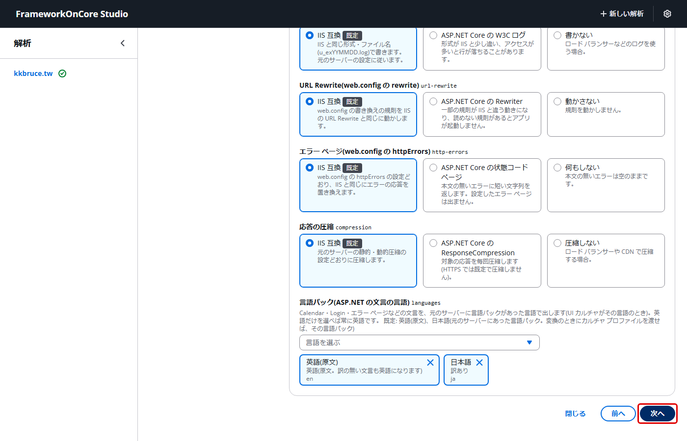

## 7. ステップ 4 変換・ビルド

**「変換してビルド」** を押します。元のアプリをステップ 1 と同じ手順でまっさらな状態からビルドし直し、.NET 10 に変換してビルドします(数分かかります)。

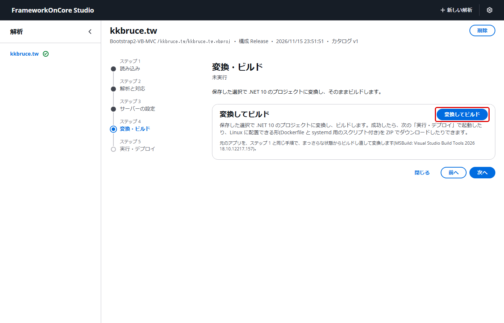

**「ビルド成功」** になり、下に変換レポートが出ます。**「未解決」が 0** であることを確かめて、**「次へ: 実行・デプロイ」** を押します。

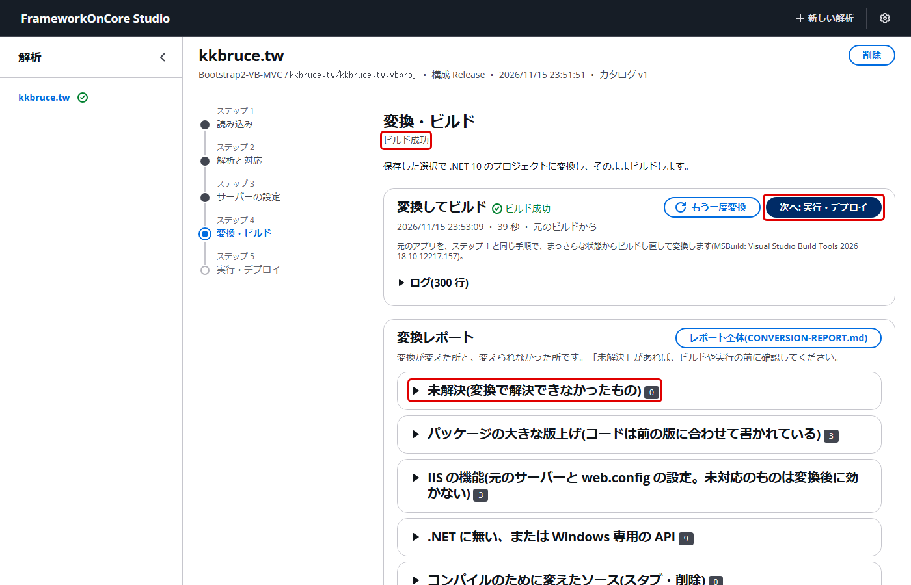

## 8. ステップ 5 実行・デプロイ

変換したアプリを動かします。「ZIP ダウンロード」では、変換の出力を Linux 用・Windows 用に取り出せます。

### 8.1 Windows で動かす(ネイティブ起動)

「ネイティブ起動(この PC)」の **「起動」** を押します。環境変数は要りません。

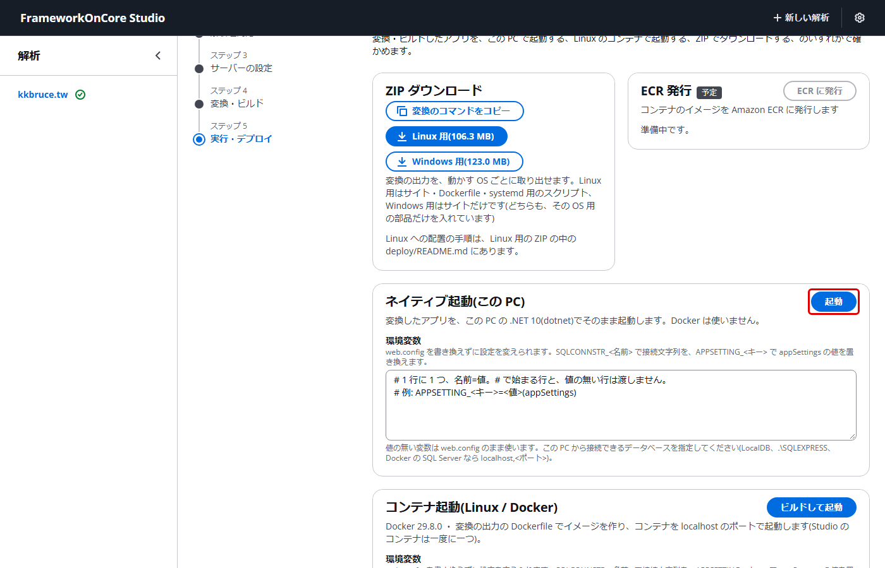

「実行中」になったら、**「開く」** を押します。最初の表示は、ページのコンパイルで時間がかかることがあります。止めるときは「停止」を押します。

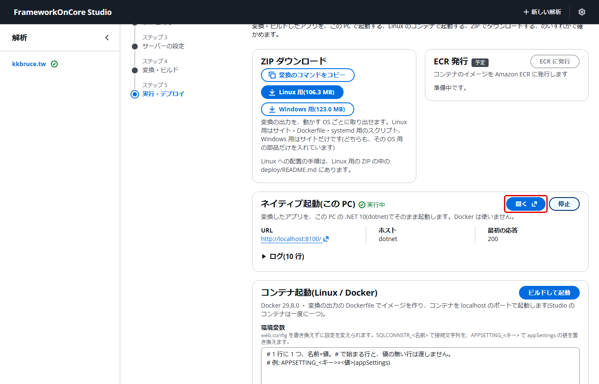

### 8.2 Linux で動かす(コンテナ起動)

Docker Desktop を起動しておきます(止まっていると「Docker Desktop を起動」ボタンが出るので、それを押しても構いません)。

「コンテナ起動(Linux / Docker)」の **「ビルドして起動」** を押します。環境変数は要りません。

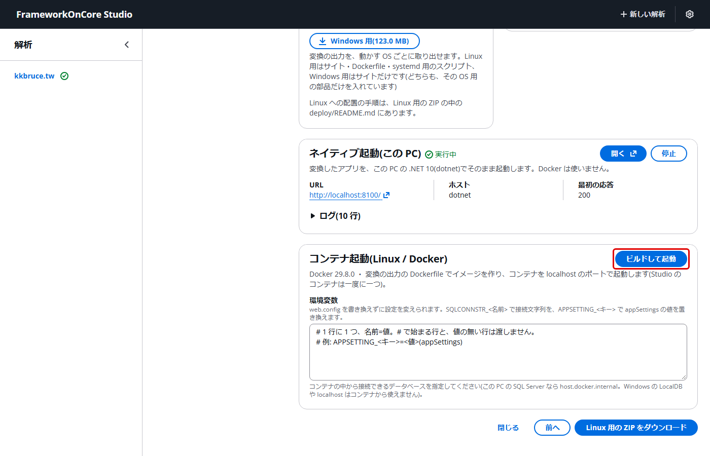

Dockerfile からイメージを作るので、初回は数分かかります。「実行中」になったら、**「開く」** を押します。止めるときは「停止」を押します。

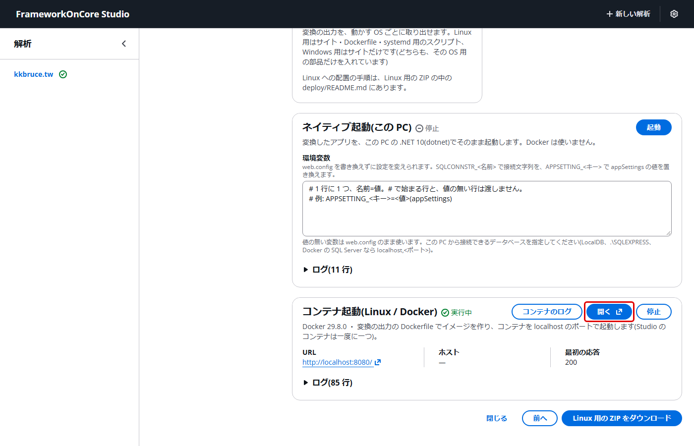

上のメニューから、各ページ(`/Bootstrap/GettingStarted`、`/Bootstrap/BaseCSS`、`/Bootstrap/Components` など)に移れます。

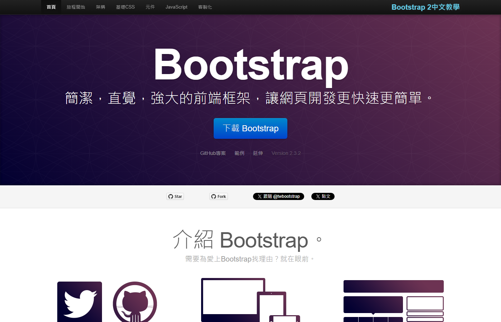

元のアプリと比べた結果は、[コマンド版の「結果」](../bootstrap2-vb-mvc.md#5-結果) にあります。

## 9. 片付け

- アプリは「停止」で止めます。Studio は、起動した PowerShell で Ctrl+C を押して止めます。Studio を止めると、Studio が起動したアプリも止まります。
- 終わったら Docker Desktop を止め、`wsl --shutdown` で WSL のメモリーを返します。
- Studio の出力は `%LOCALAPPDATA%\FrameworkOnCore\studio\` にあります。不要になった解析は、画面右上の「削除」で消せます。
