# eShopLegacyMVC を Studio で変換する

Microsoft がモダナイズの題材として公開している、カタログ管理のサンプルです(MVC 5 と Web API 2、C#)。画面(MVC)と Web API が 1 つのアプリに入っています。Studio(画面)で解析・変換し、Windows と Linux のコンテナで動かします。コマンドラインでの手順は [コマンド版](../eshop-legacy-mvc.md) です。

| | |
|---|---|
| 取得元 | [dotnet-architecture/eShopModernizing](https://github.com/dotnet-architecture/eShopModernizing) コミット `63bc9ec4`(の `eShopLegacyMVCSolution`) |
| ライセンス | MIT |

入れておくもの(.NET 10 SDK、Git、Docker Desktop、**Visual Studio または Visual Studio Build Tools**)は [共通の準備の 1](../setup.md#1-入れるもの) にあります。Studio はステップ 1 で元のアプリをビルドするので、Visual Studio か Build Tools が要ります。DB は要りません。

## 1. FrameworkOnCore とソースを取る

作業用の空のフォルダー(例: `C:\foc`。パスは短くします)を作り、FrameworkOnCore を取ります。ほかのシナリオで済ませてあれば、`cd C:\foc` だけにします。

```powershell
New-Item -ItemType Directory -Force C:\foc | Out-Null
cd C:\foc
git clone https://github.com/Shkosugi-Lab/FrameworkOnCore.git
```

同じフォルダーに、アプリのソースを取ります。

リポジトリが大きい(約 130 MB)ので、`eShopLegacyMVCSolution` のフォルダーだけを取ります。

```powershell
git clone --filter=blob:none --no-checkout https://github.com/dotnet-architecture/eShopModernizing.git
git -C eShopModernizing sparse-checkout set eShopLegacyMVCSolution
git -C eShopModernizing checkout 63bc9ec4414d7e281dc9f9d7bdcf70030950457d
```

## 2. Studio を起動する

ソースを取ったフォルダーで起動します。こうすると、Studio に入れるパスをこのフォルダーからの相対パスで書けます。

```powershell
.\FrameworkOnCore\studio.ps1
```

「Studio: http://127.0.0.1:5300/」と出たら、ブラウザーで http://127.0.0.1:5300/ を開きます。止めるときは、この PowerShell で Ctrl+C を押します。

右上の **「新しい解析」** を押します。

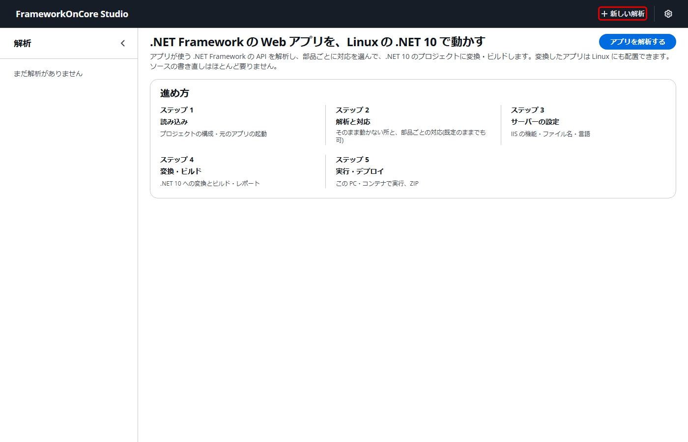

## 3. 新しい解析を作る

次の値を入れて、**「解析する」** を押します。

| 欄 | 値 |
|---|---|
| プロジェクト(.csproj / .vbproj) | `.\eShopModernizing\eShopLegacyMVCSolution\src\eShopLegacyMVC\eShopLegacyMVC.csproj` |
| リポジトリのフォルダー | `.\eShopModernizing\eShopLegacyMVCSolution` |
| 構成 | `Release` |

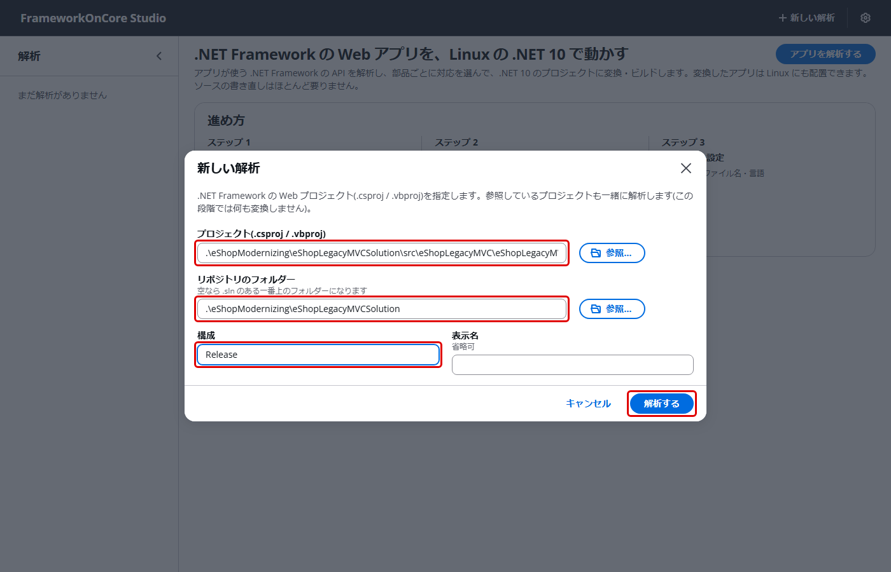

## 4. ステップ 1 読み込み

プロジェクトの構成(言語、.NET Framework の版、NuGet パッケージの数、ページの数など)が出ます。解析は裏で進みます。

下の「元のアプリのビルド」で、**「ビルドに使う MSBuild」**(Visual Studio か Build Tools。入っていないほうは選べません)を確かめて、**「ビルド」** を押します。元のアプリを、そのリポジトリのビルド手順でビルドします。**ビルドが通るまで、ステップ 2 以降には進めません。**「追加の手順」は空のままです。

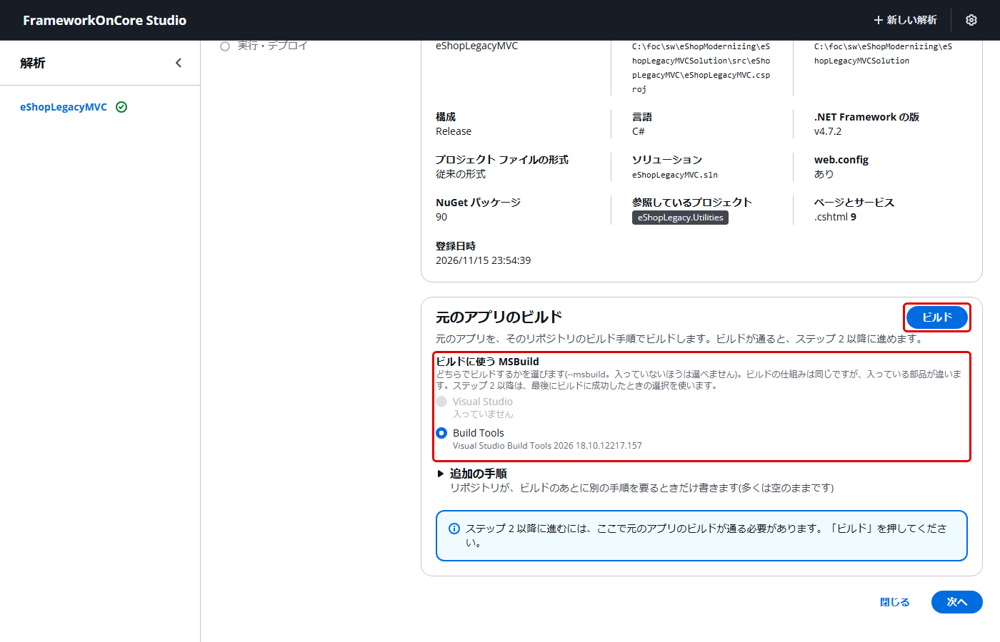

ビルド中は、その下の「ログ」にビルドの様子が出ます。**「ビルド成功」** と出たら、いちばん下の **「次へ」** を押します。

ビルドが通ると「元のアプリを起動(テスト起動)」も出ます。変換前の動きを確かめたいときに使います(IIS Express が要ります。この手順では使いません)。

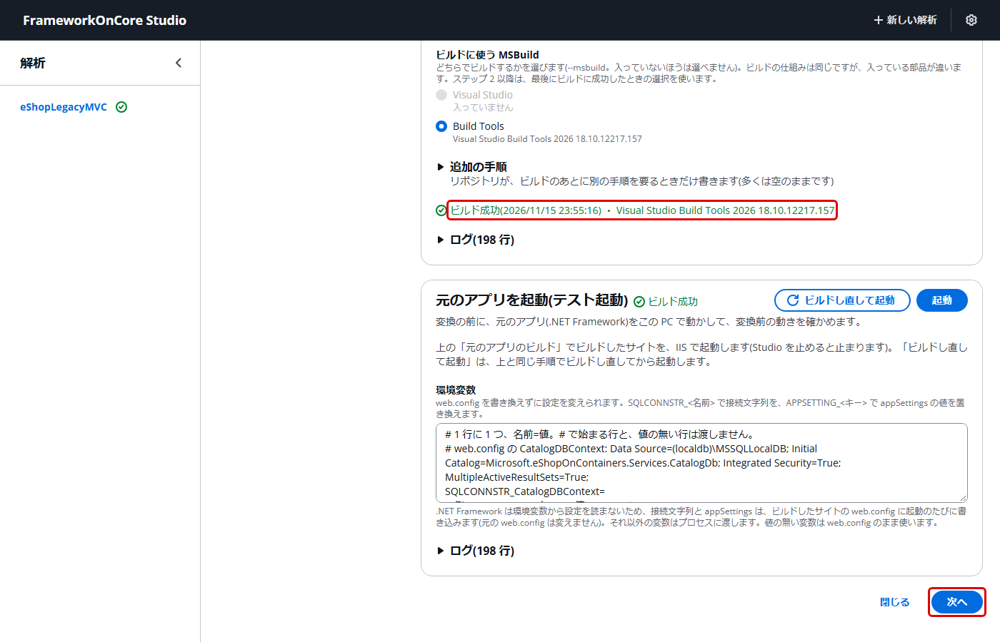

## 5. ステップ 2 解析と対応

アプリが使う .NET Framework の API と、変換での扱いが出ます。「自分で対応する所」のタブは変換だけでは動くようにならない所、「対応を選ぶ部品」のタブは部品ごとに直し方を選べる所です。

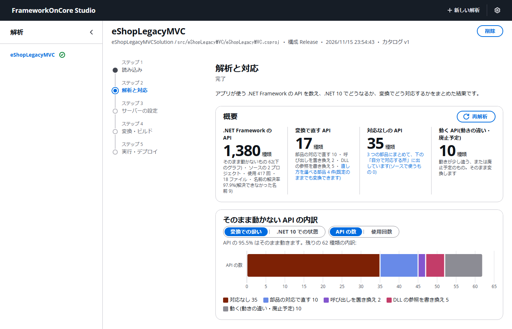

**既定のままで変換できます。** いちばん下の **「次へ」** を押します。

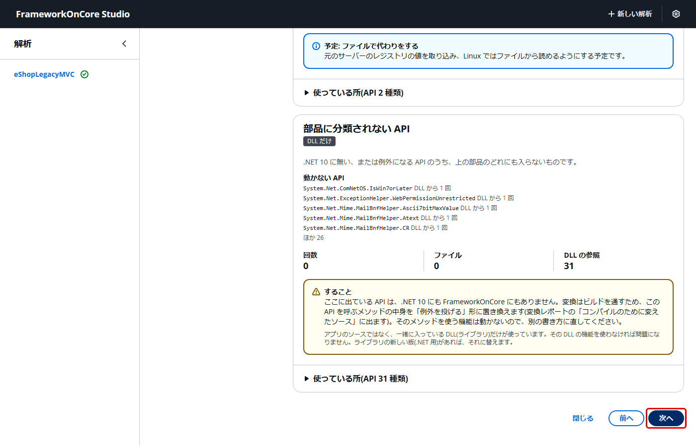

## 6. ステップ 3 サーバーの設定

IIS の機能(ファイル名の大文字・小文字、アクセス ログ、URL Rewrite、エラー ページなど)の動かし方を選べます。既定は、元の IIS と同じ動きです。既定のまま **「次へ」** を押します。

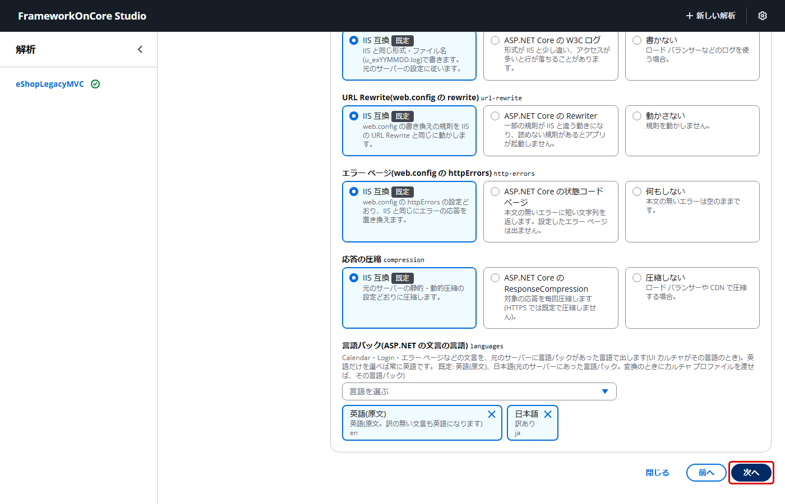

## 7. ステップ 4 変換・ビルド

**「変換してビルド」** を押します。元のアプリをステップ 1 と同じ手順でまっさらな状態からビルドし直し、.NET 10 に変換してビルドします(数分かかります)。

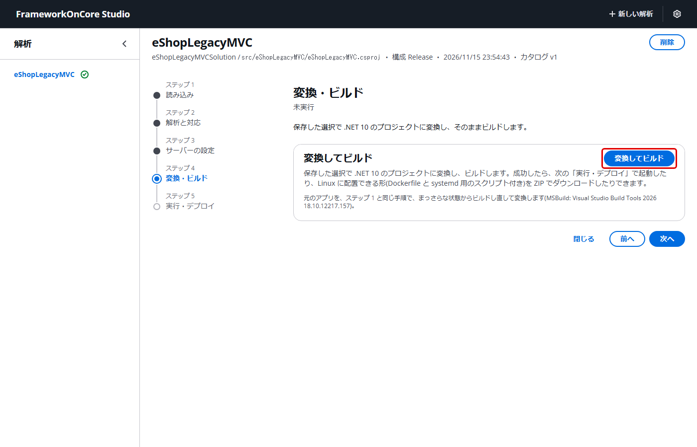

**「ビルド成功」** になり、下に変換レポートが出ます。**「未解決」が 0** であることを確かめて、**「次へ: 実行・デプロイ」** を押します。

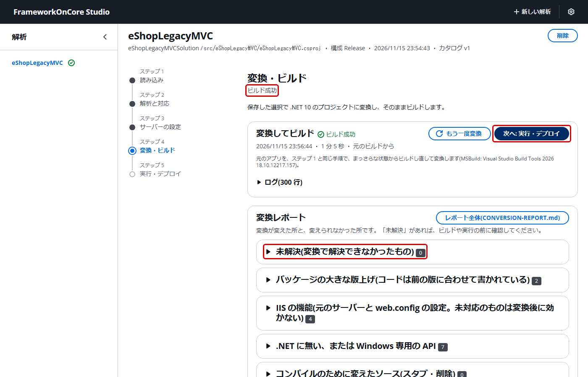

## 8. ステップ 5 実行・デプロイ

変換したアプリを動かします。「ZIP ダウンロード」では、変換の出力を Linux 用・Windows 用に取り出せます。

### 8.1 Windows で動かす(ネイティブ起動)

「ネイティブ起動(この PC)」の **「環境変数」** に、次の行を書きます(入っている例の行は消して構いません)。そして **「起動」** を押します。

```
APPSETTING_UseMockData=true
```

`APPSETTING_UseMockData=true` は、DB の代わりにモックのデータを使う設定です(web.config の appSettings の `UseMockData` を置き換えます)。

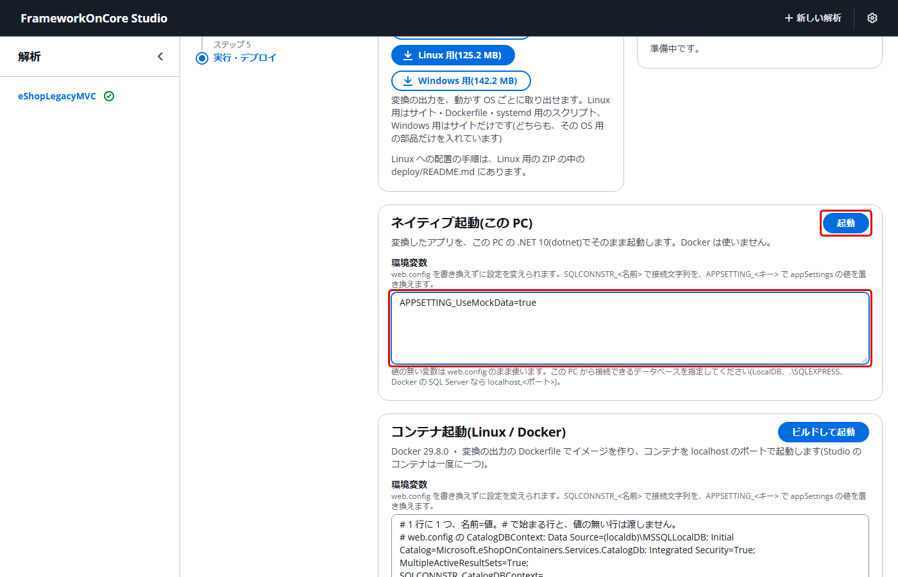

「実行中」になったら、**「開く」** を押します。最初の表示は、ページのコンパイルで時間がかかることがあります。止めるときは「停止」を押します。

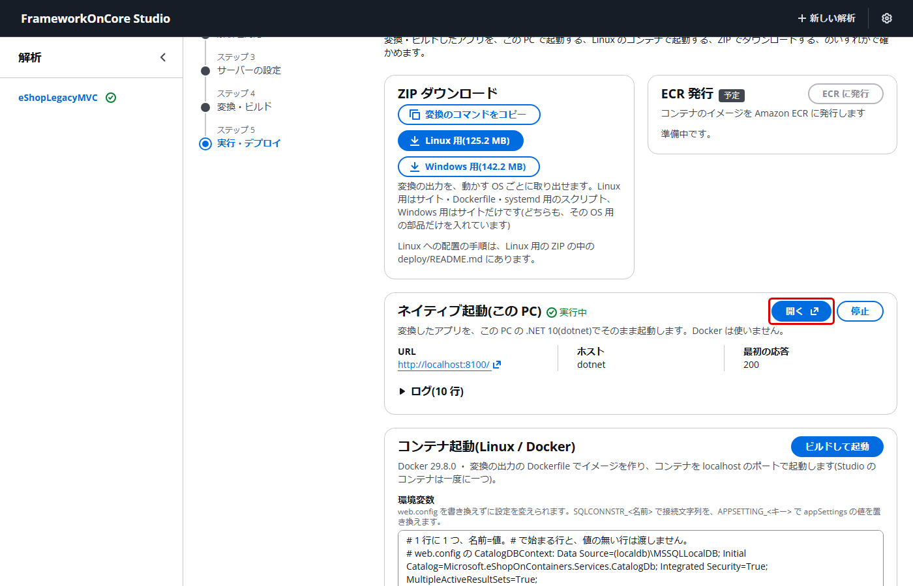

### 8.2 Linux で動かす(コンテナ起動)

Docker Desktop を起動しておきます(止まっていると「Docker Desktop を起動」ボタンが出るので、それを押しても構いません)。

「コンテナ起動(Linux / Docker)」の **「環境変数」** に、次の行を書きます(コンテナから見たこの PC は `host.docker.internal` です)。そして **「ビルドして起動」** を押します。

```
APPSETTING_UseMockData=true
```

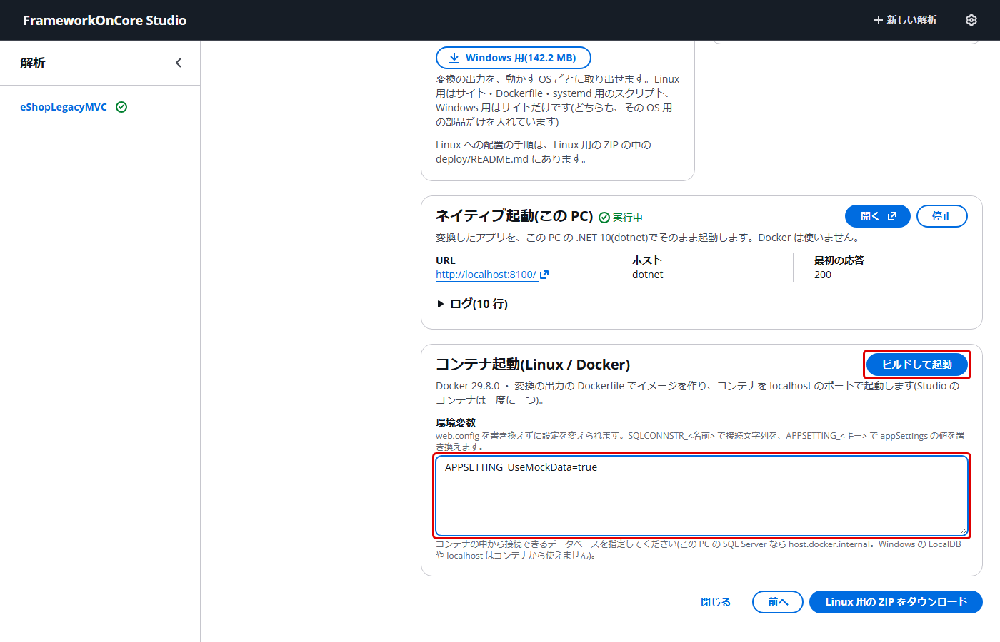

Dockerfile からイメージを作るので、初回は数分かかります。「実行中」になったら、**「開く」** を押します。止めるときは「停止」を押します。

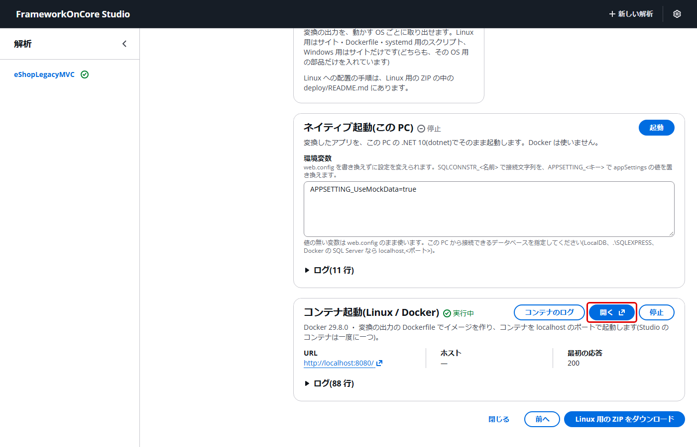

カタログの一覧です。商品の詳細は `/Catalog/Details/1`、Web API は `/api/brands`(ブランドの一覧の JSON)です。

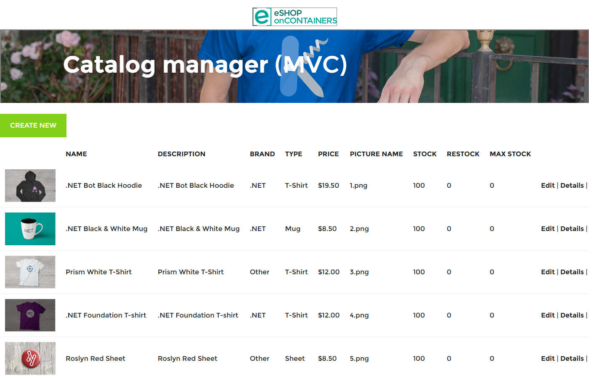

元のアプリと比べた結果は、[コマンド版の「結果」](../eshop-legacy-mvc.md#5-結果) にあります。

## 9. 片付け

- アプリは「停止」で止めます。Studio は、起動した PowerShell で Ctrl+C を押して止めます。Studio を止めると、Studio が起動したアプリも止まります。
- 終わったら Docker Desktop を止め、`wsl --shutdown` で WSL のメモリーを返します。
- Studio の出力は `%LOCALAPPDATA%\FrameworkOnCore\studio\` にあります。不要になった解析は、画面右上の「削除」で消せます。
