# openIMIS 24.10 を Studio で変換する

健康保険の管理システムです(Web Forms、VB、SQL Server)。Studio(画面)で解析・変換し、Windows と Linux のコンテナで動かします。コマンドラインでの手順は [コマンド版](../openimis.md) です。

| | |
|---|---|
| 取得元 | アプリ: [openimis/web_app_vb](https://github.com/openimis/web_app_vb) コミット `f21970b3`<br>DB: [openimis/database_ms_sqlserver](https://github.com/openimis/database_ms_sqlserver) タグ `24.10` |
| ライセンス | AGPL-3.0 |

入れておくもの(.NET 10 SDK、Git、Docker Desktop、**Visual Studio または Visual Studio Build Tools**)は [共通の準備の 1](../setup.md#1-入れるもの) にあります。Studio はステップ 1 で元のアプリをビルドするので、Visual Studio か Build Tools が要ります。SQL Server はコンテナで動かします(下の 2)。

## 1. FrameworkOnCore とソースを取る

作業用の空のフォルダー(例: `C:\foc`。パスは短くします)を作り、FrameworkOnCore を取ります。ほかのシナリオで済ませてあれば、`cd C:\foc` だけにします。

```powershell
New-Item -ItemType Directory -Force C:\foc | Out-Null
cd C:\foc
git clone https://github.com/Shkosugi-Lab/FrameworkOnCore.git
```

同じフォルダーに、アプリのソースを取ります。

アプリと、DB のスクリプトの 2 つを取ります。

```powershell
curl.exe -L -o openimis.zip https://github.com/openimis/web_app_vb/archive/f21970b3136d8083f2da6bb774652614c1ffd247.zip
tar -xf openimis.zip
Rename-Item web_app_vb-f21970b3136d8083f2da6bb774652614c1ffd247 web_app_vb
curl.exe -L -o imisdb.zip https://github.com/openimis/database_ms_sqlserver/archive/refs/tags/24.10.zip
tar -xf imisdb.zip          # database_ms_sqlserver-24.10 ができる
```

## 2. DB を用意する

SQL Server のコンテナを起動し([共通の準備の 5](../setup.md#5-sql-server-を使うとき))、DB `imis` を作ります。スキーマ、ストアド プロシージャ、デモのデータの順にスクリプトを流します(数分かかります)。Windows と Linux で同じ DB を使えます。

```powershell
docker run -d --name foc-sql -p 14330:1433 -e ACCEPT_EULA=Y -e "MSSQL_SA_PASSWORD=Foc_local_Passw0rd" mcr.microsoft.com/mssql/server:2022-latest
Start-Sleep 20
$sqlcmd = '/opt/mssql-tools18/bin/sqlcmd', '-S', 'localhost', '-U', 'sa', '-P', 'Foc_local_Passw0rd', '-C'
docker exec foc-sql @sqlcmd -Q "CREATE DATABASE imis"
$sql = '.\database_ms_sqlserver-24.10\sql'
foreach ($f in @(Get-ChildItem "$sql\base\*.sql") + @(Get-ChildItem "$sql\stored_procedures\*.sql") + @(Get-ChildItem "$sql\demo\*.sql")) {
    docker cp $f.FullName foc-sql:/tmp/script.sql
    docker exec foc-sql @sqlcmd -d imis -f 65001 -i /tmp/script.sql | Out-Null
}
```

ARM の PC(Windows on ARM)では、SQL Server の代わりに Azure SQL Edge を起動し([共通の準備の 5](../setup.md#arm-の-pcwindows-on-armでは))、Windows の `sqlcmd`(`winget install sqlcmd`)でスクリプトを流します。

```powershell
docker run -d --name foc-sql -p 14330:1433 -e ACCEPT_EULA=1 -e "MSSQL_SA_PASSWORD=Foc_local_Passw0rd" mcr.microsoft.com/azure-sql-edge
Start-Sleep 20
$sqlcmd = '-S', 'localhost,14330', '-U', 'sa', '-P', 'Foc_local_Passw0rd', '-C'
sqlcmd @sqlcmd -Q "CREATE DATABASE imis"
$sql = '.\database_ms_sqlserver-24.10\sql'
foreach ($f in @(Get-ChildItem "$sql\base\*.sql") + @(Get-ChildItem "$sql\stored_procedures\*.sql") + @(Get-ChildItem "$sql\demo\*.sql")) {
    sqlcmd @sqlcmd -d imis -f 65001 -i $f.FullName | Out-Null
}
```

2 回目以降は、コンテナを `docker start foc-sql` で起動するだけです(DB は残っています)。

接続文字列は `IMISConnectionString` です。

## 3. Studio を起動する

ソースを取ったフォルダーで起動します。こうすると、Studio に入れるパスをこのフォルダーからの相対パスで書けます。

```powershell
.\FrameworkOnCore\studio.ps1
```

「Studio: http://127.0.0.1:5300/」と出たら、ブラウザーで http://127.0.0.1:5300/ を開きます。止めるときは、この PowerShell で Ctrl+C を押します。

右上の **「新しい解析」** を押します。

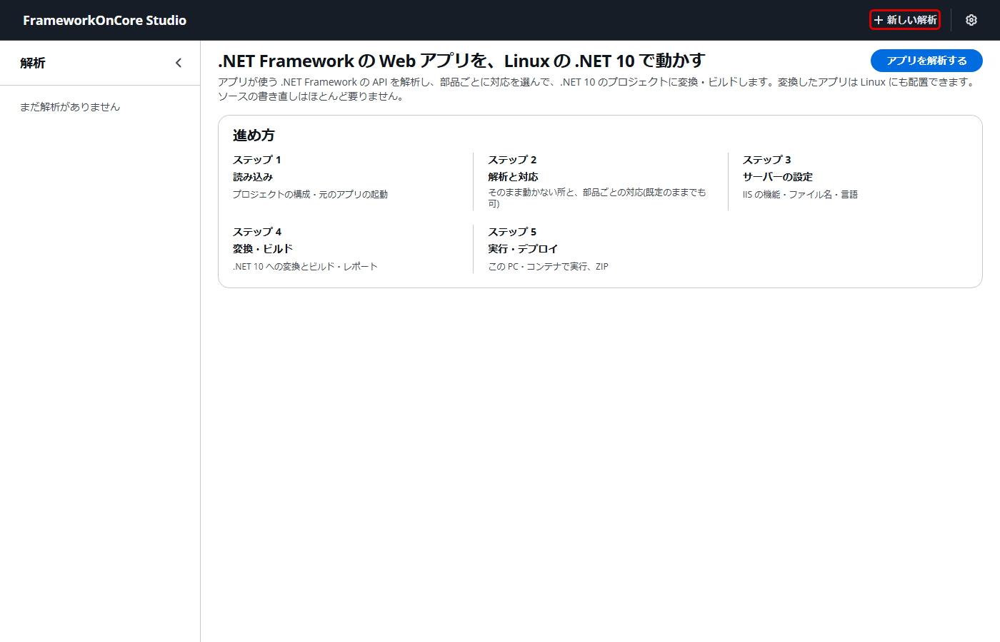

## 4. 新しい解析を作る

次の値を入れて、**「解析する」** を押します。

| 欄 | 値 |
|---|---|
| プロジェクト(.csproj / .vbproj) | `.\web_app_vb\IMIS\IMIS.vbproj` |
| リポジトリのフォルダー | `.\web_app_vb` |
| 構成 | `DemoRelease` |

構成は `Release` ではなく **`DemoRelease`** です(デモの設定のビルド)。

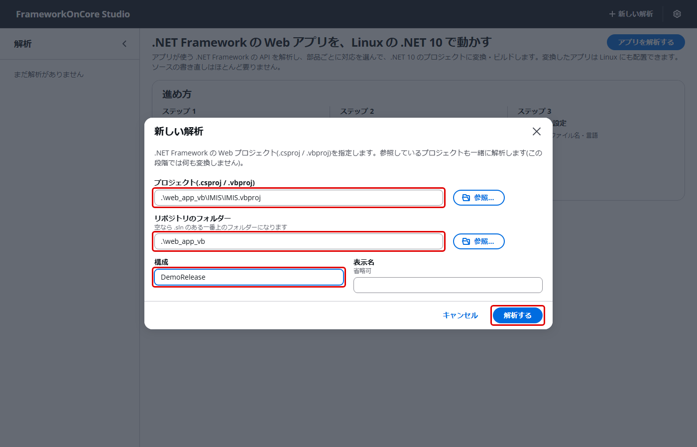

## 5. ステップ 1 読み込み

プロジェクトの構成(言語、.NET Framework の版、NuGet パッケージの数、ページの数など)が出ます。解析は裏で進みます。

下の「元のアプリのビルド」で、**「ビルドに使う MSBuild」**(Visual Studio か Build Tools。入っていないほうは選べません)を確かめて、**「ビルド」** を押します。元のアプリを、そのリポジトリのビルド手順でビルドします。**ビルドが通るまで、ステップ 2 以降には進めません。**「追加の手順」は空のままです。

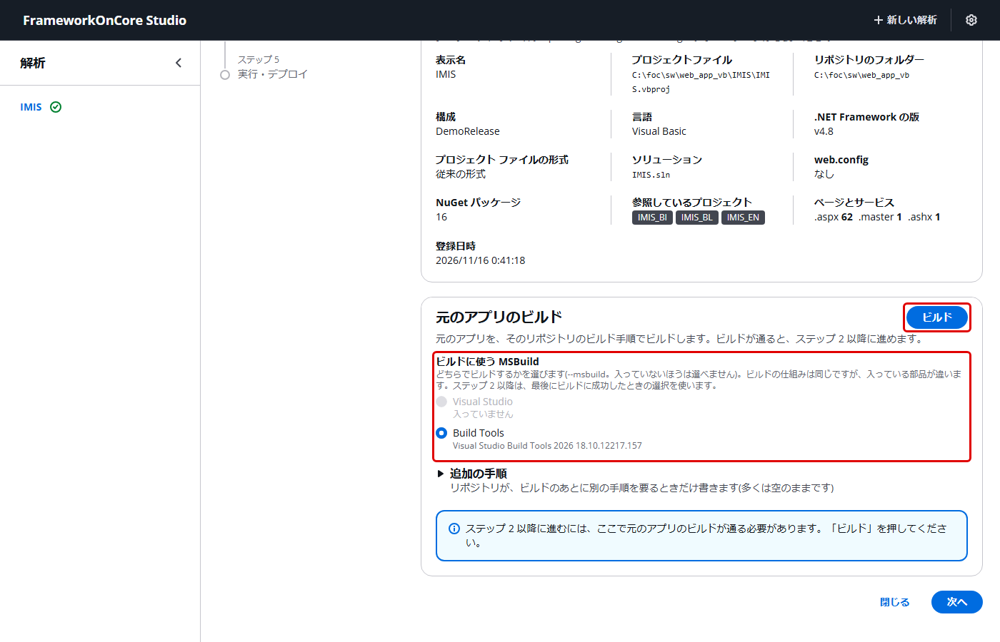

ビルド中は、その下の「ログ」にビルドの様子が出ます。**「ビルド成功」** と出たら、いちばん下の **「次へ」** を押します。

ビルドが通ると「元のアプリを起動(テスト起動)」も出ます。変換前の動きを確かめたいときに使います(IIS Express が要ります。この手順では使いません)。

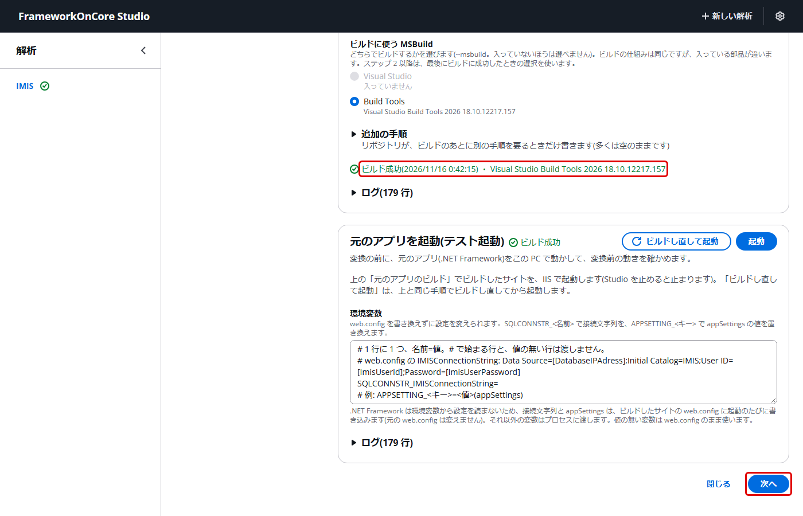

## 6. ステップ 2 解析と対応

アプリが使う .NET Framework の API と、変換での扱いが出ます。「自分で対応する所」のタブは変換だけでは動くようにならない所、「対応を選ぶ部品」のタブは部品ごとに直し方を選べる所です。

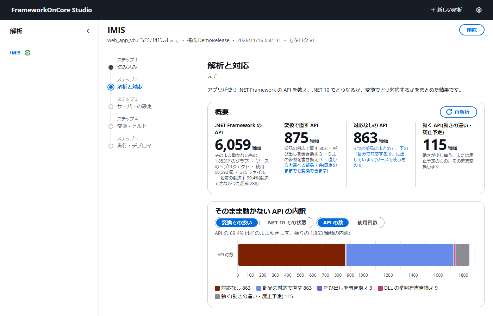

**既定のままで変換できます。** いちばん下の **「次へ」** を押します。

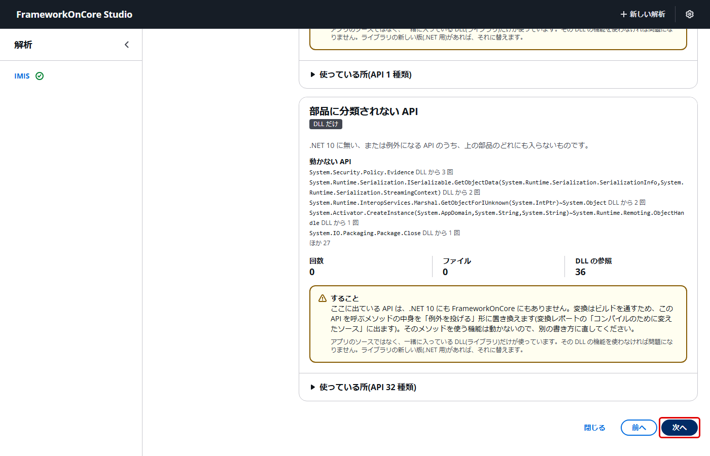

## 7. ステップ 3 サーバーの設定

IIS の機能(ファイル名の大文字・小文字、アクセス ログ、URL Rewrite、エラー ページなど)の動かし方を選べます。既定は、元の IIS と同じ動きです。既定のまま **「次へ」** を押します。

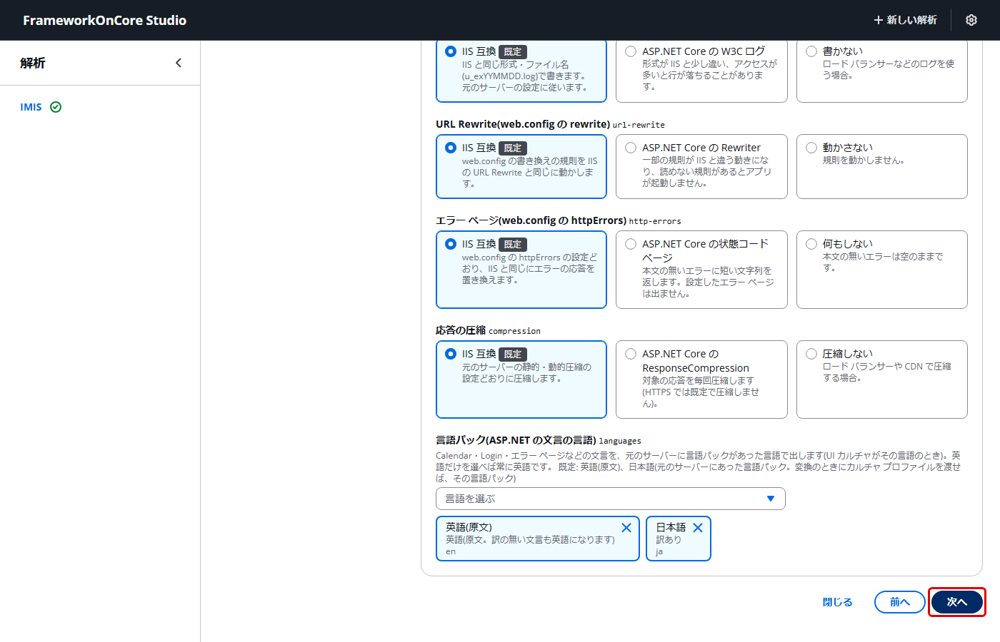

## 8. ステップ 4 変換・ビルド

**「変換してビルド」** を押します。元のアプリをステップ 1 と同じ手順でまっさらな状態からビルドし直し、.NET 10 に変換してビルドします(数分かかります)。

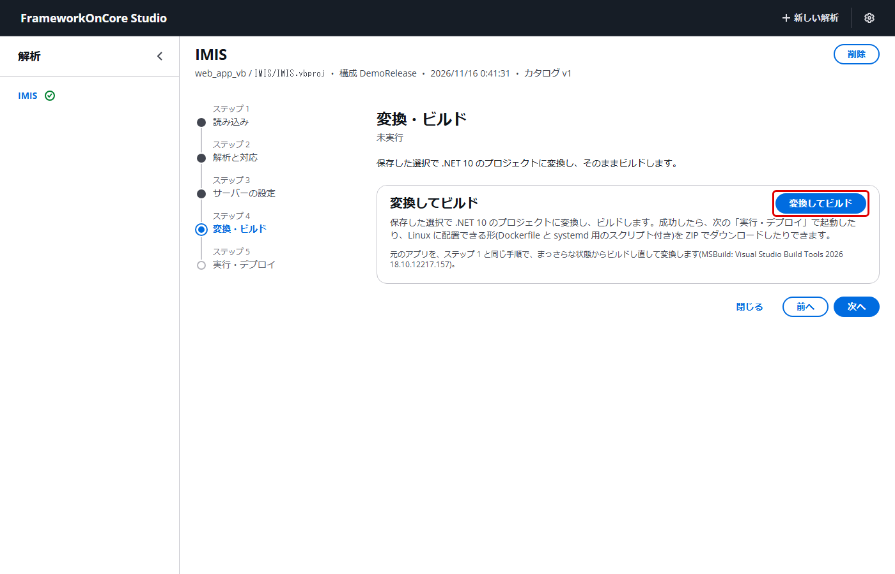

**「ビルド成功」** になり、下に変換レポートが出ます。**「未解決」が 0** であることを確かめて、**「次へ: 実行・デプロイ」** を押します。

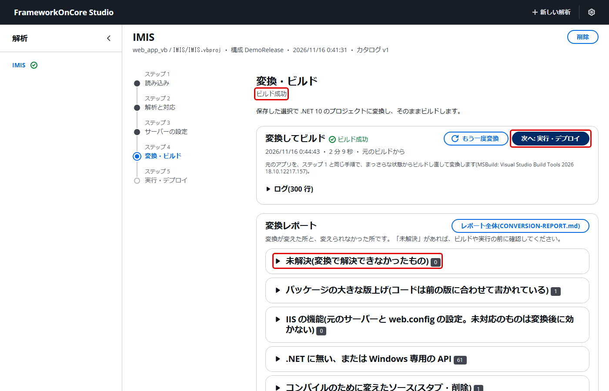

## 9. ステップ 5 実行・デプロイ

変換したアプリを動かします。「ZIP ダウンロード」では、変換の出力を Linux 用・Windows 用に取り出せます。

### 9.1 Windows で動かす(ネイティブ起動)

「ネイティブ起動(この PC)」の **「環境変数」** に、次の行を書きます(`SQLCONNSTR_<名前>` が接続文字列を置き換えます。入っている例の行は消して構いません)。そして **「起動」** を押します。

```
SQLCONNSTR_IMISConnectionString=Data Source=localhost,14330;Initial Catalog=imis;User ID=sa;Password=Foc_local_Passw0rd;TrustServerCertificate=True
```

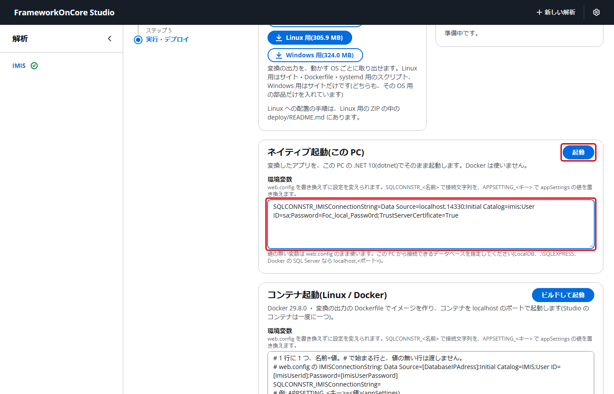

「実行中」になったら、**「開く」** を押します。最初の表示は、ページのコンパイルや DB の作成で時間がかかることがあります。止めるときは「停止」を押します。

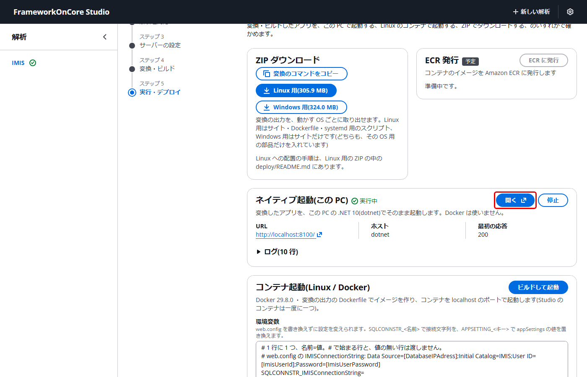

### 9.2 Linux で動かす(コンテナ起動)

Docker Desktop を起動しておきます(止まっていると「Docker Desktop を起動」ボタンが出るので、それを押しても構いません)。

「コンテナ起動(Linux / Docker)」の **「環境変数」** に、次の行を書きます(コンテナから見たこの PC は `host.docker.internal` です)。そして **「ビルドして起動」** を押します。

```
SQLCONNSTR_IMISConnectionString=Data Source=host.docker.internal,14330;Initial Catalog=imis;User ID=sa;Password=Foc_local_Passw0rd;TrustServerCertificate=True
```

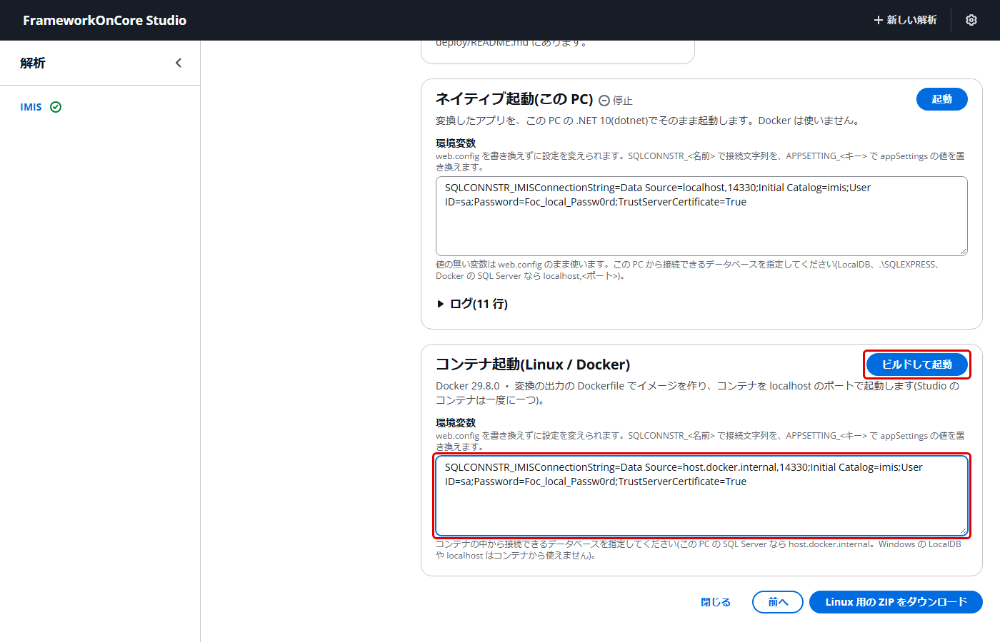

Dockerfile からイメージを作るので、初回は数分かかります。「実行中」になったら、**「開く」** を押します。止めるときは「停止」を押します。

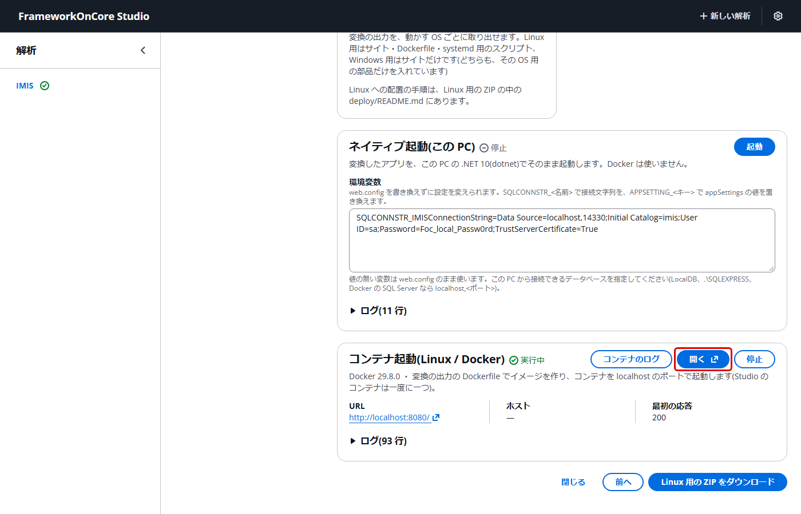

ログインの画面です。デモの `Admin` / `admin123` でログインします。

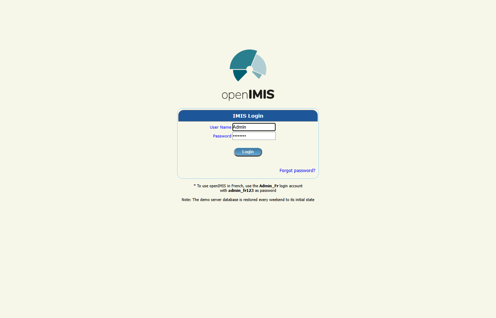

## 10. 片付け

- アプリは「停止」で止めます。Studio は、起動した PowerShell で Ctrl+C を押して止めます。Studio を止めると、Studio が起動したアプリも止まります。
- SQL Server のコンテナは `docker rm -f foc-sql` で消します(DB も消えます)。
- 終わったら Docker Desktop を止め、`wsl --shutdown` で WSL のメモリーを返します。
- Studio の出力は `%LOCALAPPDATA%\FrameworkOnCore\studio\` にあります。不要になった解析は、画面右上の「削除」で消せます。
